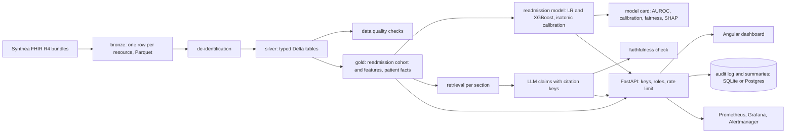

# Clinical FHIR pipeline

A hospital-style analytics platform on fully synthetic patients: FHIR R4 bundles from Synthea land in a
DuckDB and Delta Lake lakehouse, get de-identified and quality-checked, feed a calibrated 30-day
readmission-risk model with a model card that covers fairness by age and sex, and power an LLM patient
summary that cites the FHIR resources it was built from and is scored by a faithfulness eval. A FastAPI
service with API keys, per-key rate limits and an audit log of every access serves an Angular dashboard.
Docker Compose for local runs, Terraform for Azure, GitHub Actions that regenerate a cohort and run the
whole pipeline on every push.

**Status: built and verified locally (2026-10-17); not deployed.** All numbers below come from the committed
scripts on a 2,263-patient Synthea cohort generated with a fixed seed; nothing is production traffic.

## Results

<!-- RESULTS -->
- **Data quality:** 22 of 25 checks pass; 0 critical failures. Warnings: systolic blood pressure within 50-260 (2 of 31,503 rows); HbA1c within 3-20 (2,463 of 17,480 rows); no encounters after death (219 of 40,588 rows).
- **Readmission model** (2,932 admissions from 1,141 patients, 15.5% readmitted within 30 days; patient-level split, 635 held-out admissions from 229 patients): champion **xgboost** with held-out **AUROC 0.832** (95% bootstrap CI 0.785 to 0.872), AUPRC 0.437, Brier 0.088, **ECE 0.040** after isotonic calibration (uncalibrated ECE 0.028); logistic_regression AUROC 0.798, ECE 0.031.
- **Fairness (held-out):** AUROC female 0.838 vs male 0.823; selection rate at the 30% threshold female 21.5% vs male 17.6%. Age bands and race are in the model card.
- **Summary faithfulness** (qwen2.5:3b, bm25+recency, one model call per section, 40 patients, 1059 claims, 26.48 per summary, coverage 90.7% of the facts shown): **98.3% of claims supported** by the resource they cite; unsupported 18, missing citation 0, unknown citation 0, invented citation keys dropped 15; median generation 17.75 s per patient on the local GPU.
- **Same eval with qwen2.5:7b:** 97.5% of 1257 claims supported (unsupported 29, missing citation 3), coverage 92.8%, median 36.16 s per patient. The checker is the same; the model is what changes.
- **Checker self-test:** the deterministic fake model, which copies facts verbatim, scores 100.0% on 473 claims.
<!-- /RESULTS -->

How they were measured: the cohort is `scripts/synthea.sh` (Synthea v4.0.0, seed 42, Tampa, Florida,
reference and end date 2025-01-01). The model numbers are `cfp train` on a held-out fold split by patient,
with isotonic calibration fitted on a separate validation fold (`docs/MODEL-CARD.md` has every table).
The faithfulness number is `cfp eval-summaries --patients 40` with qwen2.5:3b on Ollama (RTX 4060) and the
deterministic checker described below; the same command with the fake model scores 100%, which is the
checker's own test. Data quality is `cfp quality`.

## Architecture



| Layer | What is in it |
|---|---|
| Bronze | Every resource of every bundle: type, id, patient, raw JSON. Parquet partitioned by type, plus a manifest. Identifiers live only here. |
| Silver | Ten typed, de-identified Delta tables: patients, encounters, conditions, observations (components exploded), medication requests, procedures, immunizations, allergies, diagnostic reports, care plans. |
| Gold | `admissions` (cohort, label, discharge-time features), `patient_facts` (one cited line per clinical fact), `quality_results`, `risk_scores`. |
| Model | Logistic regression and XGBoost on 46 features, split by patient, calibrated on validation, scored on test; SHAP per admission; MLflow run. |
| Summaries | Per section: BM25-plus-recency retrieval of the patient's facts, one model call with short citation keys, JSON claims mapped back to FHIR references, deterministic faithfulness verdict per claim. |
| API | `/cohort`, `/quality`, `/model/card`, `/patients`, `/patients/{id}`, `/risk`, `/facts`, `/summary`, `/audit`, `/health`, `/metrics`. Analyst and admin keys; every patient-level request is audited before the response is sent. |
| Dashboard | Cohort and quality, risk worklist, patient view with cited summary and clickable citations, model card, audit log. |

## Quick start

Needs Python 3.12 with [uv](https://docs.astral.sh/uv/), Java 11+ (for Synthea), Node 24 (dashboard), Docker.

```bash
make install                 # uv sync, npm ci
make synthea                 # downloads the pinned Synthea jar (200 MB) and generates 2,000 patients, ~1 min
cp .env.example .env         # set CFP_DEID_SALT to something long and random
make pipeline                # bronze -> silver -> quality -> gold -> train -> eval (fake model), ~2 min
make report                  # render README results and docs/MODEL-CARD.md
make up                      # Postgres, API on :8110, dashboard on :4210
```

Open http://localhost:4210, paste `local-analyst-key` (or `local-admin-key` for the audit log) into the key
box. For real summaries point `CFP_LLM_BASE_URL` at an OpenAI-compatible endpoint; with
[Ollama](https://ollama.com) on the host and `ollama pull qwen2.5:3b` the Compose default works as is.
`make up-obs` adds Prometheus (:9105), Alertmanager (:9106) and Grafana (:3007, dashboard provisioned).

## How it works

**De-identification (ADR 0002).** Names, addresses below state and 3-digit zip, phone, e-mail, SSN and
other numbers are never extracted. Birth dates become a year and an age band (90+ capped, no year). Every
date is shifted by a per-patient offset of 1 to 30 days derived from an HMAC of the patient id and a secret
salt, so intervals inside one record survive and no re-identification table exists. Free-text notes are
not extracted.

**Quality checks.** 25 SQL checks on silver with severities: ids unique, references resolve, encounters end
after they start, ages within 0 to 90, no birth year over 89, coded problems and medications, plausible
vitals and labs, no encounters after death. A failing critical check stops the pipeline; results land in
gold and in `reports/data-quality.json`. The warnings the checks raise on this cohort are listed above.

**Readmission model (ADR 0003).** Cohort and label in SQL: inpatient encounters with a discharge, labelled
by another inpatient admission within 30 days; in-hospital deaths and censored discharges excluded.
Features are all available at discharge: prior utilisation, active chronic conditions, medications, the
stay itself, latest vitals and labs, admission reason. Split by patient; champion chosen on validation;
isotonic calibration; AUROC with a bootstrap interval, AUPRC, Brier, ECE, calibration slope and intercept,
reliability curve; fairness by sex, age band, race and ethnicity; SHAP and coefficients. Every admission is
scored into `gold.risk_scores` with its split and top three factors.

**Cited summaries (ADR 0004).** Each clinical resource becomes one fact with its reference. For each
section (problems, medications, encounters, results, allergies, procedures, immunizations, care plans) the
retriever picks the top facts by a BM25 match to a clinical priority query blended with recency, the model
gets them labelled `[P1]`, `[M2]`, ... and returns claims that cite those keys; keys map back to
`Condition/<id>` and invented ones are dropped and counted. The checker then requires each claim to cite a
resource of that patient and to repeat an anchor of it (name tokens, or a value or date with a name token).
The rate reported is supported claims over all claims; the breakdown names the failure kind.

**Audit and access (ADR 0005).** Middleware writes who (key fingerprint), role, action, patient, purpose
(`X-Purpose` header), request id, address and status for every request under `/patients` and `/audit`,
including denied ones, before the response leaves; if the store is down the request fails with 503 and an
alert fires. Rate limits are per key and route.

**Observability.** JSON logs with request ids, Prometheus metrics (latency by route, patient reads, summary
latency and live faithfulness, audit rows and failures, auth denials, rate limits, model version),
OpenTelemetry traces when `OTEL_EXPORTER_OTLP_ENDPOINT` is set, a Grafana dashboard, seven alert rules with
promtool unit tests (`make alerts-test`).

## Tests

```bash
make test          # 35 Python tests: bronze, de-identification, silver, quality, gold labels and features,
                   # model (160 factory patients), summaries, faithfulness checker, audit store, API
make e2e-fixture   # deterministic cohort under data/e2e
make serve-e2e     # API on :8110 serving it (separate terminal)
make e2e           # Playwright: cohort -> worklist -> patient -> cited summary -> model card -> audit log
make alerts-test   # promtool
make tf-validate   # terraform fmt and validate in Docker
```

The unit tests build their own FHIR bundles (`tests/fhir_factory.py`) with identifiers that must disappear
and inpatient admissions with known readmission labels; no Java, no model server, no database server. CI
(`.github/workflows/ci.yml`) additionally generates 100 Synthea patients and runs the whole pipeline, runs
the audit store tests against Postgres, builds and end-to-end tests the dashboard, runs promtool, Terraform
validate, gitleaks, pip-audit and npm audit, and builds both images.

## Deployment

`infra/terraform` creates, on Azure: a storage account with hierarchical namespace for the lakehouse (the
same code reads `abfs://`), a PostgreSQL flexible server for the audit log, the API as a Container App that
scales to zero, the dashboard as a Static Web App and Log Analytics. `make deploy` builds and pushes the
image, applies the Terraform, uploads the lakehouse and publishes the dashboard; `make teardown` removes
everything. Costs and steps are in `docs/DEPLOY.md`. Not applied yet.

## Limitations

- Synthetic patients. Synthea's readmissions come from its disease modules (chemotherapy cycles,
  post-surgical care), so the model's discrimination is about the pipeline, not about hospitals.
- One machine. DuckDB and delta-rs instead of a Spark cluster (ADR 0001); the tables are Spark-readable.
- The faithfulness check is strict on paraphrase and blind to omissions; it measures copying fidelity, and
  the coverage figure (facts cited over facts shown) says how much of the record the summary used.
- Chronic-condition flags are display-text patterns, not value sets.
- Rate limiting is per process; the summary endpoint takes seconds with a local 3B model.

## Data and licences

Synthea (Apache 2.0, synthetichealth/synthea v4.0.0) generates the patients; the jar and its output are not
committed. No real personal data anywhere. Code is MIT.

## Decision records

`docs/decisions/`: 0001 DuckDB and Delta instead of a Spark cluster; 0002 Safe Harbor de-identification on
the way into silver; 0003 readmission model choices; 0004 cited summaries with a deterministic faithfulness
check; 0005 audit before the response leaves and the Azure target. `docs/PLAN.md` is the plan this was built
from; `docs/MODEL-CARD.md` is generated from the metrics.
