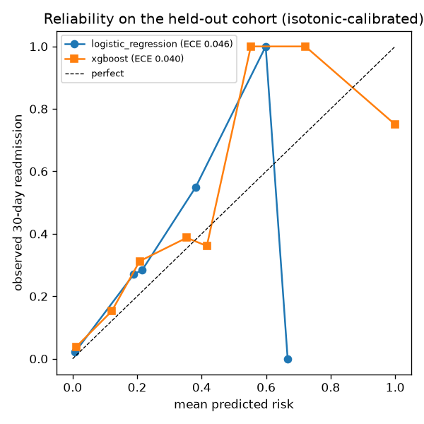
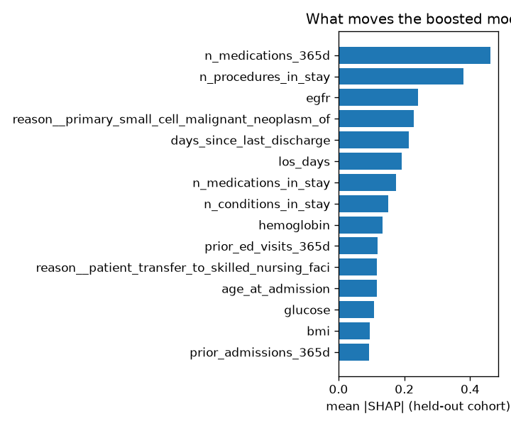

# Model card: 30-day readmission risk (readmission-v1)

Generated by `scripts/render_results.py` from `reports/model-metrics.json` on 2026-11-06. Numbers change when the
pipeline is re-run; the text does not.

## Intended use

A discharge-time estimate of the probability that an inpatient admission is followed by another inpatient
admission within 30 days, for ranking a care-transition worklist. It is trained and evaluated on **Synthea
synthetic patients only**. It must not be used on real patients without retraining, re-validation on that
population, and clinical governance. The readmission dynamics in Synthea are driven by its disease modules
(for example chemotherapy cycles and post-surgical follow-up are coded as inpatient encounters), so the
discrimination below says something about the pipeline, not about real hospitals.

## Data

- Cohort: 2,960 inpatient admissions (2,903 modeled after excluding 25 in-hospital
  deaths and 32 admissions censored because their readmission window ends after the reference
  date minus the maximum date shift) from 1,135 patients.
- Label: another inpatient admission 0 to 30 days after discharge; prevalence 15.4%.
- Split by patient: 1,850 train / 420 validation / 633 test admissions (227 test patients).
  The validation fold is used for early stopping, model selection and isotonic calibration; the test fold is
  touched once.
- Features (48): age at admission, sex, length of stay, prior utilisation (admissions, ED and ambulatory
  visits in the past year, days since the last discharge), active chronic-condition flags, medication counts,
  diagnoses and procedures during the stay, the latest vitals and labs before discharge, and the ten most
  common admission reasons. Race and ethnicity are **not** features; they are reported below.
- Label hash `70de184501c6` ties this card to the cohort it was computed on.

## Performance on the held-out cohort

| model | val AUROC | test AUROC | 95% CI | AUPRC | Brier | ECE raw | ECE calibrated | slope / intercept |
|---|---|---|---|---|---|---|---|---|
| logistic_regression | 0.854 | 0.820 | 0.746-0.895 | 0.348 | 0.103 | 0.050 | 0.046 | 0.79 / 0.16 |
| xgboost (champion) | 0.905 | 0.860 | 0.787-0.939 | 0.445 | 0.097 | 0.039 | 0.040 | 0.34 / -0.56 |

The test fold above is one patient split, and a few patients with many admissions move its score. The
same fitting and calibration on other patient splits of this cohort (`split_sensitivity` in the metrics):

| split seed | logistic_regression test AUROC | xgboost test AUROC |
|---|---|---|
| 1 | 0.734 | 0.852 |
| 2 | 0.836 | 0.875 |
| 3 | 0.884 | 0.892 |
| 4 | 0.808 | 0.883 |
| 5 | 0.922 | 0.937 |

Reliability of the champion after isotonic calibration (10 equal-width bins):

| predicted | n | mean predicted | observed |
|---|---|---|---|
| 0.0-0.1 | 412 | 1.2% | 3.9% |
| 0.1-0.2 | 46 | 12.1% | 15.2% |
| 0.2-0.3 | 48 | 20.8% | 31.2% |
| 0.3-0.4 | 80 | 35.4% | 38.8% |
| 0.4-0.5 | 36 | 41.6% | 36.1% |
| 0.5-0.6 | 2 | 55.3% | 100.0% |
| 0.7-0.8 | 1 | 72.2% | 100.0% |
| 0.9-1.0 | 8 | 100.0% | 75.0% |

## Fairness

Operating threshold 30%. Groups with fewer than 30 admissions or one class only report counts.

**By sex**

| group | n | prevalence | mean predicted | AUROC | calibration-in-the-large | selection rate | TPR | FPR |
|---|---|---|---|---|---|---|---|---|
| male | 356 | 18.8% | 15.4% | 0.802 | -0.034 | 27.2% | 58.2% | 20.1% |
| female | 277 | 8.7% | 6.7% | 0.931 | -0.019 | 10.8% | 58.3% | 6.3% |

**By age band**

| group | n | prevalence | mean predicted | AUROC | calibration-in-the-large | selection rate | TPR | FPR |
|---|---|---|---|---|---|---|---|---|
| 40-64 | 315 | 20.6% | 19.2% | 0.758 | -0.014 | 35.6% | 63.1% | 28.4% |
| 18-39 | 134 | 1.5% | 0.8% | 1.000 | -0.007 | 1.5% | 100.0% | 0.0% |
| 65-89 | 118 | 19.5% | 9.7% | 0.853 | -0.098 | 11.0% | 43.5% | 3.2% |
| 0-17 | 66 | 1.5% | 0.4% | 1.000 | -0.011 | 0.0% | 0.0% | 0.0% |

**By race**

| group | n | prevalence | mean predicted | AUROC | calibration-in-the-large | selection rate | TPR | FPR |
|---|---|---|---|---|---|---|---|---|
| unknown | 633 | 14.4% | 11.6% | 0.860 | -0.028 | 20.1% | 58.2% | 13.7% |

**By ethnicity**

| group | n | prevalence | mean predicted | AUROC | calibration-in-the-large | selection rate | TPR | FPR |
|---|---|---|---|---|---|---|---|---|
| unknown | 633 | 14.4% | 11.6% | 0.860 | -0.028 | 20.1% | 58.2% | 13.7% |

## What drives the predictions

Mean absolute SHAP on the held-out cohort (boosted model):

| feature | mean abs SHAP |
|---|---|
| n_medications_365d | 0.4621 |
| n_procedures_in_stay | 0.3801 |
| egfr | 0.2414 |
| reason__primary_small_cell_malignant_neoplasm_of | 0.2293 |
| days_since_last_discharge | 0.2136 |
| los_days | 0.1918 |
| n_medications_in_stay | 0.1748 |
| n_conditions_in_stay | 0.1522 |
| hemoglobin | 0.1331 |
| prior_ed_visits_365d | 0.1179 |
| reason__patient_transfer_to_skilled_nursing_faci | 0.1174 |
| age_at_admission | 0.1172 |

Largest standardised coefficients of the logistic regression (features with `missingindicator_` mark a value
that was absent):

| feature | coefficient |
|---|---|
| reason__patient_transfer_to_skilled_nursing_faci | -1.213 |
| reason__primary_small_cell_malignant_neoplasm_of | +1.081 |
| missingindicator_bmi | +0.715 |
| reason__dependent_drug_abuse__disorder | -0.702 |
| n_procedures_in_stay | +0.613 |
| reason__awaiting_transplantation_of_kidney__situ | -0.612 |
| n_active_conditions | +0.460 |
| reason__appendicitis__disorder | -0.453 |
| missingindicator_glucose | +0.451 |
| reason__sleep_disorder__disorder | -0.448 |
| has_heart_failure | +0.430 |
| reason__chronic_congestive_heart_failure__disord | -0.385 |

## Limitations

- Synthetic data: no real patients, no documentation quality problems, no social determinants, no payer
  data. The model has never seen a real record.
- The prediction is made at discharge with features that are all available by then; it is not a model of
  admission-time risk.
- Chronic-condition flags come from display-text patterns on SNOMED names, which is adequate for Synthea
  and would need a proper value set in production.
- Dates in the lakehouse are shifted per patient for de-identification; ages at admission are therefore
  approximate to within a month.
- Calibration is checked on 633 admissions; the per-group calibration figures for small groups are noisy.

## Companion: summary faithfulness

The cited-summary feature is evaluated separately (`reports/summary-faithfulness.json`): 91.4% of 1113 claims over 40 patients were supported by the resource they cite (qwen2.5:3b, bm25+recency).

## Monitoring

Scores are written to `gold.risk_scores` with the split each admission belonged to. The API exposes the
model version as a Prometheus gauge; a retrain is a re-run of `cfp train`, which rewrites this card.
