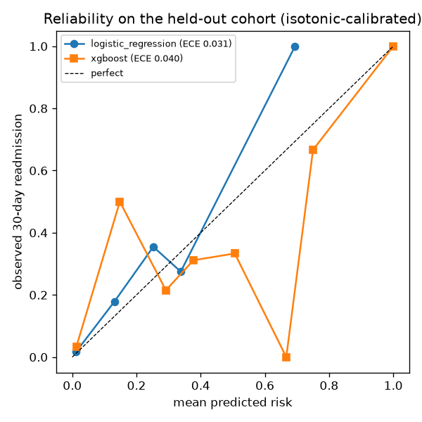
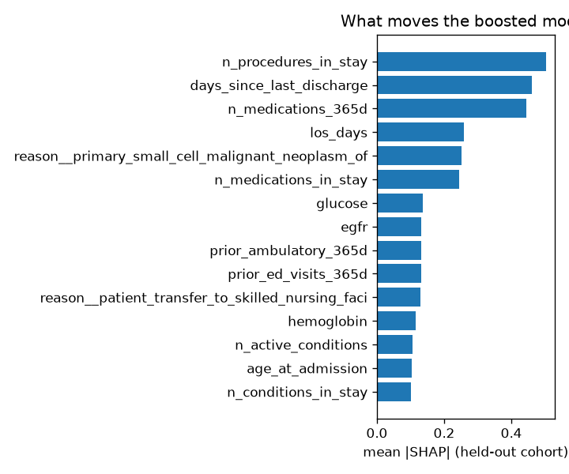

# Model card: 30-day readmission risk (readmission-v1)

Generated by `scripts/render_results.py` from `reports/model-metrics.json` on 2026-10-17. Numbers change when the
pipeline is re-run; the text does not.

## Intended use

A discharge-time estimate of the probability that an inpatient admission is followed by another inpatient
admission within 30 days, for ranking a care-transition worklist. It is trained and evaluated on **Synthea
synthetic patients only**. It must not be used on real patients without retraining, re-validation on that
population, and clinical governance. The readmission dynamics in Synthea are driven by its disease modules
(for example chemotherapy cycles and post-surgical follow-up are coded as inpatient encounters), so the
discrimination below says something about the pipeline, not about real hospitals.

## Data

- Cohort: 2,960 inpatient admissions (2,932 modeled after excluding 25 in-hospital
  deaths and 3 admissions censored by the end of the data) from 1,141 patients.
- Label: another inpatient admission 0 to 30 days after discharge; prevalence 15.5%.
- Split by patient: 1,892 train / 405 validation / 635 test admissions (229 test patients).
  The validation fold is used for early stopping, model selection and isotonic calibration; the test fold is
  touched once.
- Features (48): age at admission, sex, length of stay, prior utilisation (admissions, ED and ambulatory
  visits in the past year, days since the last discharge), active chronic-condition flags, medication counts,
  diagnoses and procedures during the stay, the latest vitals and labs before discharge, and the ten most
  common admission reasons. Race and ethnicity are **not** features; they are reported below.
- Label hash `a03ecb36f093` ties this card to the cohort it was computed on.

## Performance on the held-out cohort

| model | val AUROC | test AUROC | 95% CI | AUPRC | Brier | ECE raw | ECE calibrated | slope / intercept |
|---|---|---|---|---|---|---|---|---|
| logistic_regression | 0.841 | 0.798 | 0.754-0.839 | 0.286 | 0.095 | 0.039 | 0.031 | 0.32 / -0.84 |
| xgboost (champion) | 0.894 | 0.832 | 0.785-0.872 | 0.437 | 0.088 | 0.028 | 0.040 | 0.27 / -0.90 |

Reliability of the champion after isotonic calibration (10 equal-width bins):

| predicted | n | mean predicted | observed |
|---|---|---|---|
| 0.0-0.1 | 416 | 1.3% | 3.4% |
| 0.1-0.2 | 2 | 14.8% | 50.0% |
| 0.2-0.3 | 93 | 29.2% | 21.5% |
| 0.3-0.4 | 106 | 37.7% | 31.1% |
| 0.5-0.6 | 3 | 50.6% | 33.3% |
| 0.6-0.7 | 2 | 66.7% | 0.0% |
| 0.7-0.8 | 3 | 75.0% | 66.7% |
| 0.9-1.0 | 10 | 100.0% | 100.0% |

## Fairness

Operating threshold 30%. Groups with fewer than 30 admissions or one class only report counts.

**By sex**

| group | n | prevalence | mean predicted | AUROC | calibration-in-the-large | selection rate | TPR | FPR |
|---|---|---|---|---|---|---|---|---|
| male | 318 | 12.6% | 14.0% | 0.823 | 0.014 | 17.6% | 47.5% | 13.3% |
| female | 317 | 12.9% | 13.7% | 0.838 | 0.007 | 21.5% | 65.9% | 14.9% |

**By age band**

| group | n | prevalence | mean predicted | AUROC | calibration-in-the-large | selection rate | TPR | FPR |
|---|---|---|---|---|---|---|---|---|
| 40-64 | 365 | 18.4% | 21.3% | 0.738 | 0.030 | 32.1% | 59.7% | 25.8% |
| 18-39 | 138 | 3.6% | 1.9% | 0.882 | -0.017 | 1.4% | 40.0% | 0.0% |
| 0-17 | 75 | 4.0% | 1.2% | 0.998 | -0.028 | 0.0% | 0.0% | 0.0% |
| 65-89 | 57 | 10.5% | 11.4% | 0.824 | 0.009 | 8.8% | 66.7% | 2.0% |

**By race**

| group | n | prevalence | mean predicted | AUROC | calibration-in-the-large | selection rate | TPR | FPR |
|---|---|---|---|---|---|---|---|---|
| unknown | 635 | 12.8% | 13.8% | 0.832 | 0.011 | 19.5% | 56.8% | 14.1% |

**By ethnicity**

| group | n | prevalence | mean predicted | AUROC | calibration-in-the-large | selection rate | TPR | FPR |
|---|---|---|---|---|---|---|---|---|
| unknown | 635 | 12.8% | 13.8% | 0.832 | 0.011 | 19.5% | 56.8% | 14.1% |

## What drives the predictions

Mean absolute SHAP on the held-out cohort (boosted model):

| feature | mean abs SHAP |
|---|---|
| n_procedures_in_stay | 0.5040 |
| days_since_last_discharge | 0.4619 |
| n_medications_365d | 0.4435 |
| los_days | 0.2581 |
| reason__primary_small_cell_malignant_neoplasm_of | 0.2522 |
| n_medications_in_stay | 0.2456 |
| glucose | 0.1358 |
| egfr | 0.1325 |
| prior_ambulatory_365d | 0.1315 |
| prior_ed_visits_365d | 0.1314 |
| reason__patient_transfer_to_skilled_nursing_faci | 0.1295 |
| hemoglobin | 0.1147 |

Largest standardised coefficients of the logistic regression (features with `missingindicator_` mark a value
that was absent):

| feature | coefficient |
|---|---|
| reason__primary_small_cell_malignant_neoplasm_of | +1.043 |
| reason__patient_transfer_to_skilled_nursing_faci | -1.026 |
| reason__dependent_drug_abuse__disorder | -0.891 |
| n_active_conditions | +0.665 |
| prior_admissions_365d | +0.564 |
| n_procedures_in_stay | +0.516 |
| reason__awaiting_transplantation_of_kidney__situ | -0.496 |
| missingindicator_bmi | +0.476 |
| reason__appendicitis__disorder | -0.476 |
| reason__sleep_disorder__disorder | -0.460 |
| reason__history_of_coronary_artery_bypass_grafti | +0.407 |
| n_conditions_in_stay | -0.355 |

## Limitations

- Synthetic data: no real patients, no documentation quality problems, no social determinants, no payer
  data. The model has never seen a real record.
- The prediction is made at discharge with features that are all available by then; it is not a model of
  admission-time risk.
- Chronic-condition flags come from display-text patterns on SNOMED names, which is adequate for Synthea
  and would need a proper value set in production.
- Dates in the lakehouse are shifted per patient for de-identification; ages at admission are therefore
  approximate to within a month.
- Calibration is checked on 635 admissions; the per-group calibration figures for small groups are noisy.

## Companion: summary faithfulness

The cited-summary feature is evaluated separately (`reports/summary-faithfulness.json`): 98.3% of 1059 claims over 40 patients were supported by the resource they cite (qwen2.5:3b, bm25+recency).

## Monitoring

Scores are written to `gold.risk_scores` with the split each admission belonged to. The API exposes the
model version as a Prometheus gauge; a retrain is a re-run of `cfp train`, which rewrites this card.
