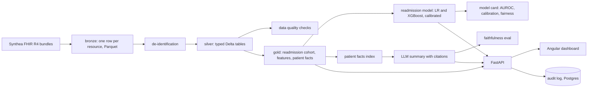

# Plan

Written before the code; updated where the build changed it.

## Goal

A hospital-style analytics platform on fully synthetic patients: a lakehouse with de-identification and data
quality checks, a calibrated 30-day readmission-risk model with a model card that covers fairness by age and
sex, and an LLM patient summary that cites the FHIR resources it was built from, with a faithfulness eval and
an audit log of every access. Angular dashboard, FastAPI, Docker, Terraform for Azure.

## Data

Synthea v4.0.0 (Apache 2.0), FHIR R4 bundles, Florida population, fixed seed. No real people exist in the
data. The pipeline reads the generated bundles only; the jar and its output are not committed. CI generates
a 100-patient cohort with the same seed and runs the whole pipeline on it; the README numbers come from a
2,000-patient local run with the committed scripts.

## Architecture

- **Lakehouse:** DuckDB does the SQL, delta-rs writes Delta tables, so the tables are readable from Spark,
  Databricks or Fabric unchanged. One machine and a few million resources do not need a cluster (ADR 0001).
- **De-identification:** Safe Harbor style on the way into silver: names, addresses below state and 3-digit
  zip, phone, email, SSN, licence and passport numbers dropped; birth dates reduced to year and age band
  (90+ capped); every date shifted by a per-patient offset derived from an HMAC of the patient id and a
  secret salt, so intervals inside one patient survive. No re-identification table is written (ADR 0002).
- **Quality checks:** SQL checks on silver (ids unique, references resolve, dates ordered, vitals in range,
  codes present) with severities; a failing critical check stops the pipeline and the results land in gold.
- **Readmission model:** cohort = inpatient encounters with a discharge; label = another inpatient admission
  within 30 days; features use only history before the admission. Split by patient; logistic regression and
  XGBoost; isotonic calibration on the validation fold; AUROC, AUPRC, Brier, expected calibration error, a
  reliability curve; SHAP; fairness by sex and age band (AUROC, calibration-in-the-large, selection rate at
  the operating threshold). Tracked in MLflow; the model card is rendered from the metrics file (ADR 0003).
- **Summaries:** the patient's own silver rows become short facts, each with its FHIR reference. Retrieval
  per section (problems, medications, encounters, results, allergies) with BM25 or Ollama embeddings; the
  LLM returns JSON claims with citations restricted to the retrieved fact ids. The eval checks every claim:
  it has a citation, the citation is a resource of that patient, and the claim repeats an anchor (name, value
  or year) of the cited resource. Faithfulness rate = supported claims / all claims (ADR 0004).
- **API and audit:** API keys with analyst and admin roles, per-key rate limit, request ids, JSON logs,
  Prometheus metrics, OpenTelemetry. Every read of patient data writes an audit row (who, what, which
  patient, purpose, when) before the response leaves (ADR 0005).
- **Dashboard:** Angular, four views: cohort and quality, risk list with calibration, patient (facts,
  risk factors, cited summary), audit log.
- **Deployment:** Terraform for Azure (storage account with hierarchical namespace for the lakehouse,
  Container Apps for the API, Static Web App for the dashboard, PostgreSQL flexible server for the audit
  log, Log Analytics). Compose for local runs. Not applied without the owner's login and cost approval.

## Numbers to produce

- Readmission model: AUROC, AUPRC, Brier and ECE on a held-out patient cohort, with the reliability curve.
- Summary faithfulness rate over a sample of patients with the local model, and the breakdown of failures.

## Milestones

1. Synthea run, bronze, de-identification, silver, quality checks.
2. Gold cohort and features, model, calibration, fairness, model card.
3. Facts, retrieval, summaries, faithfulness eval, audit log.
4. API, dashboard, end-to-end test.
5. Observability, Compose, Terraform, CI, documentation.
